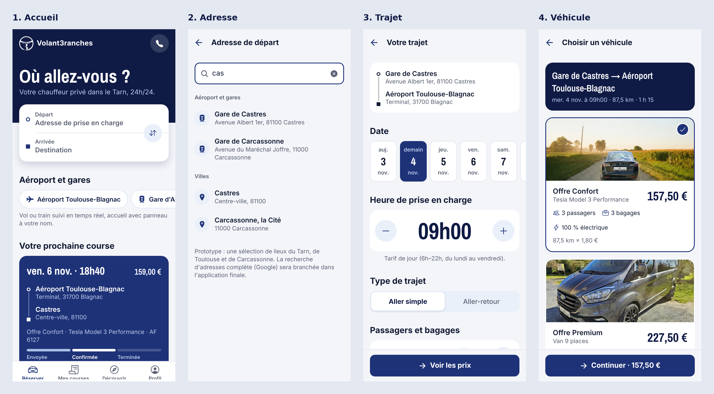
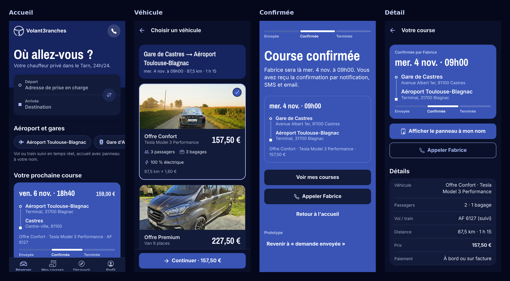

# Volant3ranches VTC — application mobile de réservation

Application iOS et Android pour réserver une course auprès de **Volant3ranches VTC**, le service
de chauffeur privé de Fabrice Legouez Ricoce, basé à Viterbe (Tarn) : transferts aéroport et gares
(Toulouse-Blagnac, Albi, Castres, Carcassonne), trajets professionnels, mise à disposition et longues
distances, en Tesla Model 3 Performance ou en Van 9 places.

Site actuel : <https://volant3ranches-vtc.fr>

> **État : prototype de démonstration.** Les écrans et le parcours sont complets, mais les données
> sont fictives et aucune demande n'est réellement envoyée. Il sert à valider l'application avec
> Fabrice avant le développement complet.





## Le principe

1. Le client choisit son départ et son arrivée (raccourcis aéroport et gares), la date, l'heure,
   le nombre de passagers et de bagages, et son numéro de vol ou de train.
2. Il voit tout de suite le **prix** des deux offres, calculé au kilomètre avec les tarifs du site
   (majoration nuit, week-end et jours fériés, aller-retour à -5 %, minimum de course).
3. Il envoie une **demande** sans créer de compte. Fabrice la confirme sous 30 minutes ; le client est
   prévenu par notification, SMS et email.
4. Il retrouve ses courses, peut appeler Fabrice, annuler (frais selon les CGV) et afficher le
   **panneau à son nom** pour le hall des arrivées.

Pas de paiement en ligne : paiement à bord ou sur facture.

## Identité visuelle

Direction **« Bleu pastel du Lauragais »** : le bleu de la guède, teinture qui a fait la richesse
d'Albi et de Toulouse. Seuls le logo et le nom viennent du site ; couleurs et typographie ont été
redéfinies pour sortir du style « crème et or » jugé trop générique.

- Le statut d'une course **se teinte** comme un tissu à chaque bain : bleu pâle quand la demande est
  envoyée, indigo profond quand Fabrice confirme, bleu délavé quand elle est terminée.
- **Cuve d'indigo vivante** : en fond de l'accueil, un bain de teinture rendu en 3D temps réel
  (shader WebGL, `mobile/src/CuveIndigo.tsx`) dérive lentement et suit l'inclinaison du téléphone.
  Quand Fabrice confirme, l'encre monte du bas et envahit l'écran. L'effet s'arrête hors écran et
  devient une image fixe si « Réduire les animations » est activé.
- **Le trajet en relief** : sur le choix du véhicule et la confirmation, une carte 3D stylisée du Tarn,
  du Lauragais et de la Montagne Noire (rendu WebGL temps réel, `mobile/src/TrajetRelief.tsx`). La caméra
  survole la région pendant que l'itinéraire se dessine en arc entre le départ et l'arrivée, puis une
  lumière parcourt le trajet. Relief stylisé, positions des villes réelles. L'animation s'arrête hors
  écran et devient une image fixe si « Réduire les animations » est activé.
- **Mode clair et mode sombre.** L'application suit le réglage du téléphone ; on peut aussi forcer
  l'un ou l'autre dans Profil › Apparence.
- Photos réelles de Fabrice et des véhicules, reprises du site.

## Contenu du dépôt

| Chemin | Contenu |
|---|---|
| `mobile/` | Le prototype (Expo / React Native, TypeScript, Expo Router) |
| `mobile/app/` | Les écrans : `(tabs)/` pour les 4 onglets, puis adresse, trajet, offre, coordonnées, confirmation, détail de course, panneau |
| `mobile/src/data.ts` | Contenu repris du site : tarifs, véhicules, prestations, FAQ, avis, CGV, contact |
| `mobile/src/theme.ts` | Les deux palettes (clair et sombre) et la typographie |
| `mobile/assets/photos/` | Logo et photos du site |
| `PRODUCT.md` | Contexte produit : clients, règles métier, contraintes, décisions ouvertes |
| `docs/brief-reservation.md` | Brief de conception du parcours de réservation et plan de statistiques (GA4) |
| `docs/prototype/` | Captures des écrans |

## Tester sur un téléphone

### Ce qu'il faut

- Un ordinateur avec [Node.js](https://nodejs.org) 20 ou plus récent et Git.
- Un iPhone ou un téléphone Android avec l'application **Expo Go**
  ([App Store](https://apps.apple.com/app/expo-go/id982107779) ·
  [Google Play](https://play.google.com/store/apps/details?id=host.exp.exponent)), à jour.

### Étapes

1. Récupérer le projet :

   ```bash
   git clone https://github.com/ZKS-Tech/app-vtc-volant3ranches.git
   ```

   ```bash
   cd app-vtc-volant3ranches/mobile
   ```

   Tant que le travail n'est pas fusionné dans la branche principale, se placer sur la branche du
   prototype :

   ```bash
   git checkout claude/trusting-cannon-qpd5r6
   ```

2. Installer les dépendances (une seule fois) :

   ```bash
   npm install
   ```

3. Lancer le serveur de développement :

   ```bash
   npm run telephone
   ```

   Cette commande (`npx expo start --tunnel ngrok`) passe par un tunnel : elle marche quel que soit
   le réseau, y compris sous WSL, sans compte Expo. Sur un même Wi-Fi sans WSL, `npx expo start`
   suffit et se recharge plus vite.

4. Un QR code s'affiche dans le terminal :
   - **iPhone** : le scanner avec l'appareil photo, puis ouvrir dans Expo Go ;
   - **Android** : le scanner depuis Expo Go.

L'ordinateur et le téléphone doivent être sur le **même réseau Wi-Fi**. Si le téléphone n'arrive pas
à se connecter (Wi-Fi d'entreprise, partage de connexion…), lancer plutôt :

```bash
npx expo start --tunnel
```

Chaque modification du code s'affiche immédiatement sur le téléphone.

### Dépannage : « Something went wrong » dans Expo Go

- **Sous Windows avec WSL**, le QR code pointe vers une adresse interne à WSL (souvent `172.x.x.x`)
  que le téléphone ne peut pas joindre. Utiliser le tunnel :

  ```bash
  npx expo login
  ```

  ```bash
  npx expo start --tunnel
  ```

  Le tunnel demande d'être connecté à un compte Expo (gratuit). Sans compte, utiliser
  `npx expo start --tunnel ngrok` et accepter l'installation de `@expo/ngrok`.
  En se connectant aussi dans Expo Go avec le même compte, le projet apparaît directement dans
  l'application, sans QR code.
- Vérifier que le téléphone et l'ordinateur sont sur le même Wi-Fi et que le pare-feu Windows
  autorise Node.js sur les réseaux privés.
- Mettre à jour Expo Go : le projet utilise Expo SDK 58.
- Dans Expo Go, « View error log » donne le message exact ; le terminal d'`npx expo start` aussi.

### Autres façons de l'essayer

- **Dans le navigateur** : `npx expo start --web` (pratique pour un aperçu rapide, mais le rendu
  final est celui du téléphone).
- **Simulateur** : dans le terminal d'`npx expo start`, touche `i` pour le simulateur iOS (Mac avec
  Xcode) ou `a` pour l'émulateur Android (Android Studio).

### Scénario à dérouler avec Fabrice

1. Accueil : choisir « Gare de Castres » en départ, puis le raccourci « Aéroport Toulouse-Blagnac ».
2. Choisir la date et l'heure ; essayer une heure après 22h pour voir la majoration de nuit.
3. Passer à 4 passagers : la Tesla devient indisponible, le Van est proposé.
4. Remplir les coordonnées, accepter les CGV, envoyer la demande.
5. Sur « Demande envoyée », toucher **« Simuler la confirmation de Fabrice »** : l'écran passe à
   l'indigo.
6. Mes courses › ouvrir la course › « Afficher le panneau à mon nom », puis « Annuler la course »
   pour voir les frais.
7. Profil › Prototype › **« Simuler un échec d'envoi »**, puis refaire une réservation pour voir
   l'écran d'erreur.
8. Profil › Apparence › « Sombre » pour voir le mode sombre.

## Limites du prototype

- Seule une sélection de lieux (Tarn, Toulouse, Carcassonne) est proposée et la distance est
  estimée ; la version finale utilisera Google pour les adresses et la distance réelle par la route.
- Les courses de « Claire Martin » sont des exemples ; rien n'est enregistré ni envoyé.
- Comptes, notifications, SMS et emails ne sont pas encore branchés.

## Prochaines étapes

- Valider les écrans et les décisions ouvertes avec Fabrice (voir `PRODUCT.md`) : outil de
  confirmation des demandes, attente gratuite à l'aéroport (30 min sur le site, 15 min dans les CGV),
  majoration du week-end absente des CGV.
- Serveur de réservation et outil de confirmation pour Fabrice.
- Adresses et distances Google, notifications push, SMS et emails.
- Statistiques **Firebase Analytics (GA4)**, avec consentement, sur le parcours décrit dans
  `docs/brief-reservation.md`.
- Version installable sans ordinateur pour les testeurs (EAS Build, TestFlight / test interne
  Google Play), puis publication sur les stores.

## Outils

- [Expo](https://expo.dev) SDK 58, React Native, Expo Router, TypeScript.
- Le skill de conception [Impeccable](https://github.com/pbakaus/impeccable) est installé dans
  `.claude/skills/` pour Claude Code (`/impeccable critique`, `/impeccable polish`…).

Vérifier le code avant un commit :

```bash
cd mobile && npx tsc --noEmit
```
