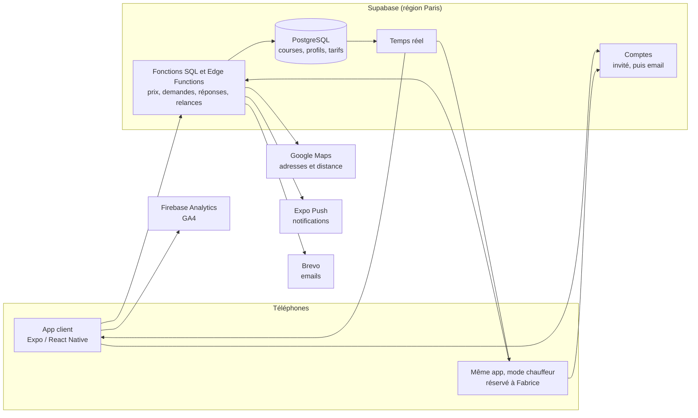
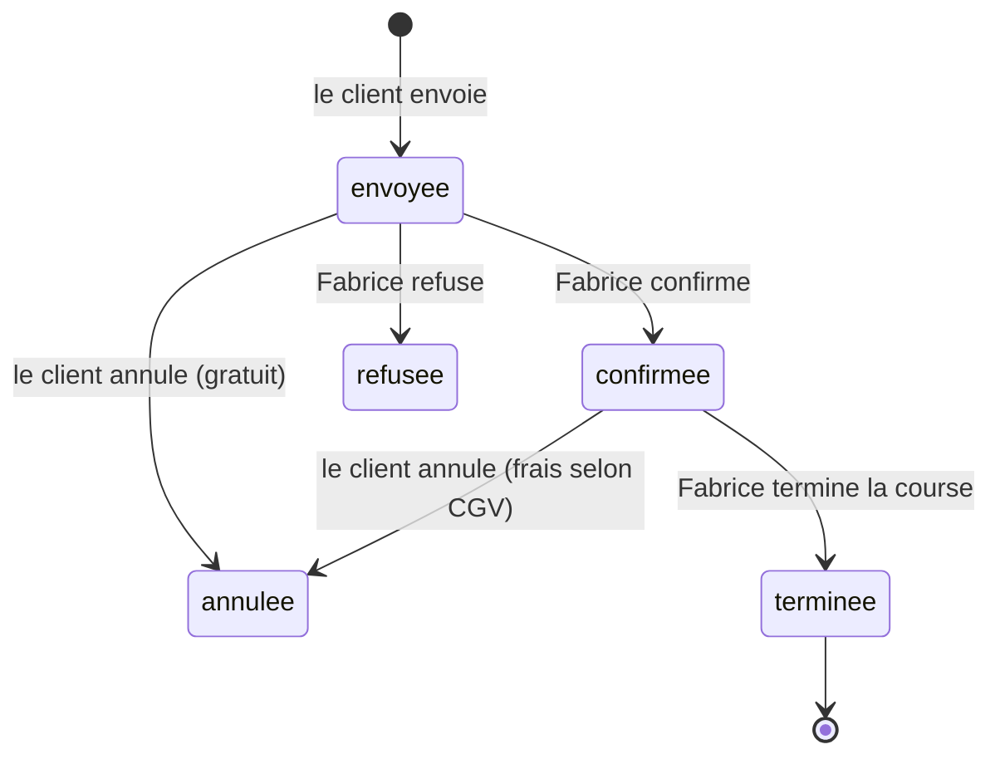

# Architecture et ordre de développement

Choix validé : **Supabase** (base SQL PostgreSQL) et des services gratuits au démarrage, **sans SMS**
pour l'instant. Contexte produit : [PRODUCT.md](../PRODUCT.md).

## Vue d'ensemble

## Les briques

| Brique | Choix | Coût au démarrage |
|---|---|---|
| Application | **Expo / React Native** (le prototype validé), une seule appli pour les clients et Fabrice | Gratuit |
| Base de données, comptes, temps réel, fonctions serveur | **Supabase**, offre gratuite, région Paris | Gratuit |
| Adresses et distances | **Google Places + Routes**, appelés par une fonction serveur (clé jamais dans l'appli) | Quota gratuit mensuel |
| Notifications | **Expo Push** | Gratuit |
| Emails de confirmation | **Brevo** | Gratuit (environ 300 emails par jour) |
| Statistiques | **Firebase Analytics = GA4** (compte Google existant), avec consentement | Gratuit |
| SMS | Pas pour l'instant | — |
| Versions de test et publication | EAS Build / Update ; Apple Developer et Google Play à la publication | 99 €/an Apple, 25 $ une fois Google |

**À savoir sur l'offre gratuite Supabase :** un projet sans aucune activité pendant une semaine est mis
en pause ; on le relance d'un clic dans le tableau de bord. Une fois l'appli publiée, l'activité des
réservations le maintient éveillé ; l'offre payante (environ 25 $ par mois) reste possible si besoin.

## La base de données

Fichier : [`supabase/migrations/20261104000000_fondations.sql`](../supabase/migrations/20261104000000_fondations.sql).

| Table | Contenu |
|---|---|
| `offres` | Les deux offres et leurs prix (jour, majoré, minimum, capacités). **Modifiables par Fabrice.** |
| `parametres` | Heures de nuit, majoration week-end, coefficient aller-retour, arrondi, attentes gratuites, délai de confirmation. |
| `jours_feries` | Jours fériés 2026 à 2028. |
| `courses` | Les demandes : adresses, date, passagers, véhicule, distance, prix, coordonnées, statut et horodatages. |
| `profils` | Un par compte : rôle (`client` ou `chauffeur`), nom, téléphone, email. |

Cycle de vie d'une course :

**Toutes les écritures passent par des fonctions** qui vérifient les règles :

| Fonction | Qui | Rôle |
|---|---|---|
| `calculer_prix` | tous | Mêmes règles que le site : nuit, samedi, dimanche, jours fériés, aller-retour, minimum, arrondi à 0,50 €. |
| `creer_demande` | client | Vérifie capacités, date et coordonnées, **recalcule le prix**, enregistre la demande. |
| `repondre_demande` | Fabrice | Confirme ou refuse une demande en attente. |
| `terminer_course` | Fabrice | Passe une course confirmée en terminée. |
| `annuler_course` | client | Annule ; frais selon les CGV (gratuit si pas encore confirmée ou à plus de 24 h, 50 % entre 24 h et 12 h, 100 % à moins de 12 h). |

**Sécurité (Row Level Security)** : un client ne lit que ses courses, ne peut ni insérer une course
directement (donc ni truquer un prix), ni changer un statut, ni se donner le rôle de chauffeur. Ces
règles sont vérifiées par un jeu de 21 tests exécutés sur un PostgreSQL local avant chaque livraison.

## Ordre de développement

1. **Fondations** ✅ : base de données, sécurité, tarifs en base, connexion de l'appli (compte invité
   automatique), demandes enregistrées, confirmation reçue en temps réel.
2. **Réservation réelle** : vraies adresses et vraie distance par la route via une Edge Function Google ;
   la distance n'est plus transmise par l'appli mais calculée par le serveur.
3. **Mode chauffeur** : compte de Fabrice ; onglets Demandes (avec le délai de 30 min), Planning,
   Historique ; Confirmer / Refuser / Terminer.
4. **Notifications et emails** : notification à Fabrice à chaque demande, au client à la confirmation,
   email récapitulatif (Brevo), relance après 30 min sans réponse, rappel la veille.
5. **Comptes clients** : passer du compte invité à un compte email pour retrouver ses courses sur un
   autre téléphone ; adresses favorites.
6. **Statistiques et confidentialité** : GA4 avec consentement ; politique de confidentialité du site
   mise à jour.
7. **Publication** : version de développement (EAS), test par Fabrice et quelques clients, stores.

**Ensuite :** SMS, suivi de Fabrice en approche, version anglaise, paiement en ligne, factures
entreprise, formulaire du site branché sur la même base.
