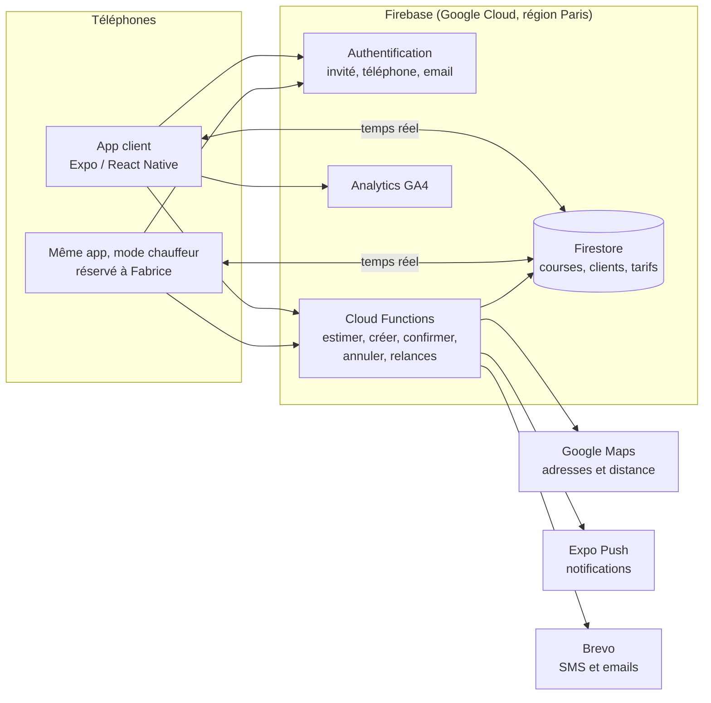
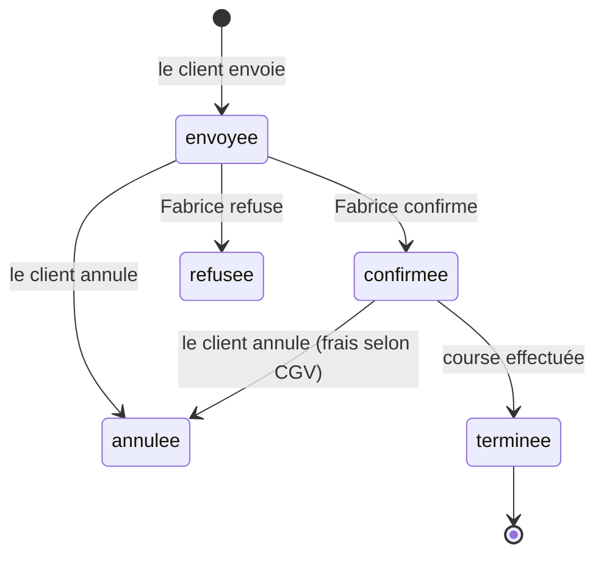

# Architecture et ordre de développement

Proposition pour passer du prototype validé à l'application réelle. Contexte produit : [PRODUCT.md](../PRODUCT.md).

## Vue d'ensemble

## Les briques

| Brique | Choix proposé | Pourquoi |
|---|---|---|
| Application | **Expo / React Native** (le prototype), une seule appli pour les clients et Fabrice | On garde tout le travail validé. Le mode chauffeur n'apparaît que sur le compte de Fabrice. |
| Serveur et données | **Firebase** : Authentification, Firestore, Cloud Functions, hébergement des données en **région Paris** | Cohérent avec GA4 (même console Google), temps réel natif pour voir la confirmation arriver, rien à administrer, gratuit à ce volume. |
| Adresses et distances | **Google Places + Routes**, appelés uniquement par le serveur | Comme le site actuel. La clé n'est jamais dans l'appli, et le prix est recalculé côté serveur : le client ne peut pas le modifier. |
| Notifications | **Expo Push** (iOS et Android) | Intégré à Expo, gratuit. |
| SMS et emails | **Brevo** | Entreprise française, données en Europe, SMS et emails transactionnels au même endroit. |
| Statistiques | **Firebase Analytics = GA4**, avec consentement | Le site et l'appli peuvent être réunis dans la même propriété GA4. |
| Versions et mises à jour | **EAS Build** (TestFlight, test interne Google Play) et **EAS Update** | Mises à jour des textes, prix affichés et corrections sans repasser par les stores. |

Alternative au serveur : **Supabase** (base PostgreSQL, hébergement européen). Bon choix aussi ; Firebase
est recommandé ici surtout pour GA4 et les notifications.

## Les données

- **`tarifs`** : prix au km jour et majoré par véhicule, minimums, horaires de nuit, jours fériés,
  remise aller-retour, attentes gratuites. **Modifiables par Fabrice sans nouvelle version de l'appli.**
- **`courses`** : départ, arrivée, date, passagers, bagages, numéro de vol, véhicule, prix, client,
  statut, horodatage de chaque changement.
- **`clients`** : nom, téléphone, email, adresses favorites, préférences de notification, consentement.

Cycle de vie d'une course :

## Les fonctions serveur

| Fonction | Rôle |
|---|---|
| `estimer` | Distance réelle par la route (Google) puis prix avec les tarifs en vigueur. En cas d'échec : un message, jamais un prix inventé. |
| `creerDemande` | Vérifie la demande, **recalcule le prix**, l'enregistre, prévient Fabrice (notification + SMS de secours). Si l'envoi échoue, l'appli le dit et propose de réessayer. |
| `confirmer` / `refuser` | Réservées au compte de Fabrice. Préviennent le client par notification, SMS et email. |
| `annuler` | Calcule les frais selon les CGV (gratuit > 24 h, 50 % entre 24 h et 12 h, 100 % < 12 h). |
| Tâches planifiées | Relance de Fabrice puis message au client si rien après 30 min ; rappel au client la veille. |

Les règles de sécurité Firestore garantissent qu'un client ne lit que ses courses, et que seul Fabrice
change un statut.

## Ordre de développement

Chaque étape se termine par une version testable sur téléphone.

1. **Fondations.** Projet Firebase (région Paris), passage d'Expo Go à une *development build* (nécessaire
   pour Firebase et les notifications), configuration EAS, vérifications automatiques du code.
2. **Réservation réelle.** Vraies adresses, vraie distance, prix calculé par le serveur à partir des
   tarifs en base, demande enregistrée. L'appli remplace les données de démonstration.
3. **Mode chauffeur et confirmation.** Compte de Fabrice ; onglets Demandes (avec le délai de 30 min),
   Planning, Historique ; Confirmer / Refuser. Côté client, la confirmation arrive en temps réel et
   déclenche l'animation de l'encre.
4. **Notifications.** Push pour Fabrice et le client, SMS et email récapitulatif, relance après 30 min,
   rappel la veille, annulation avec frais.
5. **Comptes clients.** Invité par défaut, puis compte par téléphone ou email pour retrouver ses courses,
   adresses favorites.
6. **Statistiques et confidentialité.** GA4 avec écran de consentement, événements du parcours
   (voir `brief-reservation.md`), mise à jour de la politique de confidentialité du site.
7. **Publication.** Icône, écran de démarrage, fiches App Store et Google Play, test par Fabrice et
   quelques clients via TestFlight et Google Play, puis publication.

**Ensuite :** suivi de Fabrice en approche le jour J, version anglaise, paiement en ligne, factures
entreprise, et branchement du formulaire du site sur le même serveur pour tout centraliser.

## Ce qu'il faudra créer (comptes)

| Compte | Coût indicatif |
|---|---|
| Firebase / Google Cloud, avec facturation activée (nécessaire aux Cloud Functions) | Gratuit à ce volume ; paiement à l'usage au-delà |
| Clé Google Maps (Places + Routes) | Quota gratuit mensuel, largement suffisant au démarrage |
| Expo (déjà créé) | Gratuit pour ce projet |
| Apple Developer | 99 € par an |
| Google Play Console | 25 $ une fois |
| Brevo | Emails gratuits au démarrage ; SMS à quelques centimes l'unité |

Les tarifs exacts sont à vérifier au moment de l'ouverture des comptes.
