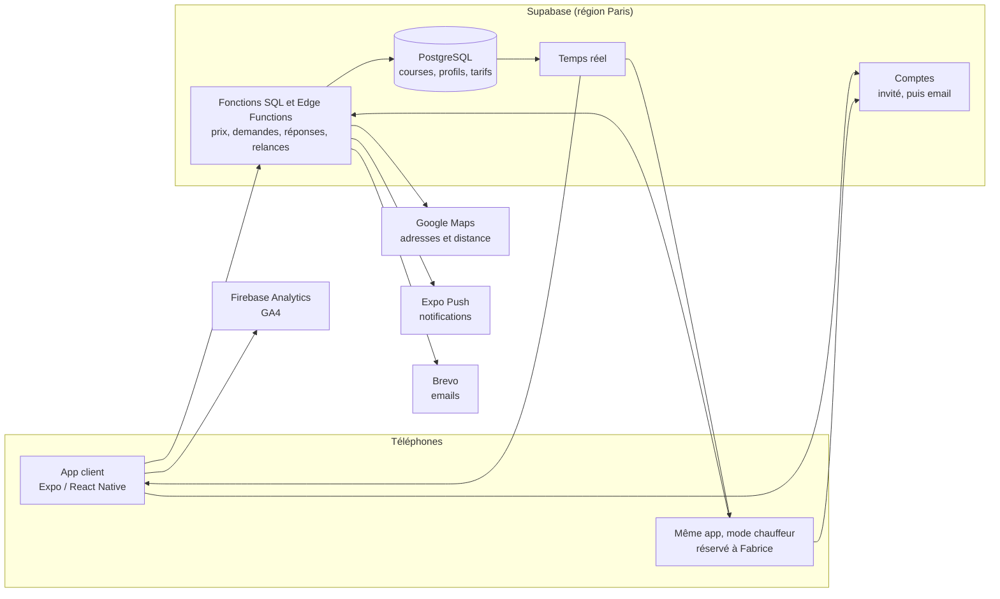
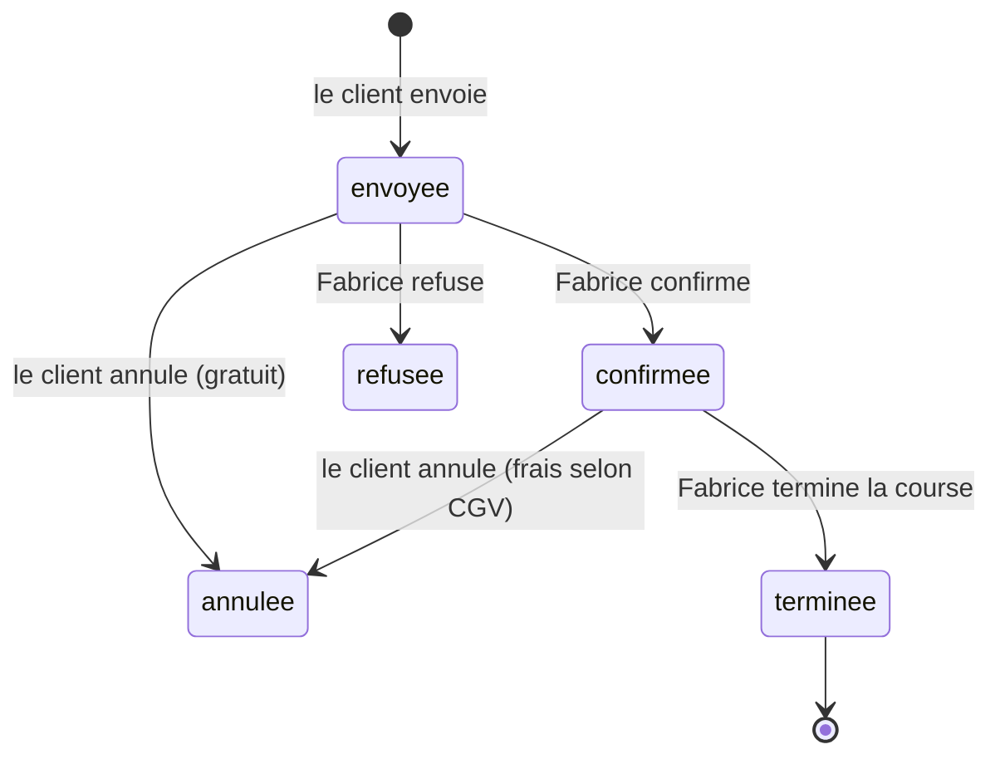

# Architecture et ordre de développement

Choix validé : **Supabase** (base SQL PostgreSQL) et des services gratuits au démarrage, **sans SMS**
pour l'instant. Contexte produit : [PRODUCT.md](../PRODUCT.md).

## Vue d'ensemble

## Les briques

| Brique | Choix | Coût au démarrage |
|---|---|---|
| Application | **Expo / React Native** (le prototype validé), une seule appli pour les clients et Fabrice | Gratuit |
| Base de données, comptes, temps réel, fonctions serveur | **Supabase**, offre gratuite, région Paris | Gratuit |
| Adresses et distances | **Géoplateforme de l'IGN** : géocodage (Base Adresse Nationale) et itinéraire, gratuits et sans clé ; la base recalcule la distance de chaque demande | Gratuit |
| Notifications | **Expo Push** | Gratuit |
| Emails de confirmation | **Brevo** | Gratuit (environ 300 emails par jour) |
| Statistiques | **Firebase Analytics = GA4** (compte Google existant), avec consentement | Gratuit |
| SMS | Pas pour l'instant | — |
| Versions de test et publication | EAS Build / Update ; Apple Developer et Google Play à la publication | 99 €/an Apple, 25 $ une fois Google |

**À savoir sur l'offre gratuite Supabase :** un projet sans aucune activité pendant une semaine est mis
en pause ; on le relance d'un clic dans le tableau de bord. Une fois l'appli publiée, l'activité des
réservations le maintient éveillé ; l'offre payante (environ 25 $ par mois) reste possible si besoin.

## La base de données

Fichier : [`supabase/migrations/20261104000000_fondations.sql`](../supabase/migrations/20261104000000_fondations.sql).

| Table | Contenu |
|---|---|
| `offres` | Les deux offres et leurs prix (jour, majoré, minimum, capacités). **Modifiables par Fabrice.** |
| `parametres` | Heures de nuit, majoration week-end, coefficient aller-retour, arrondi, attentes gratuites, délai de confirmation. |
| `jours_feries` | Jours fériés 2026 à 2028. |
| `courses` | Les demandes : adresses, date, passagers, véhicule, distance, prix, coordonnées, statut et horodatages. |
| `profils` | Un par compte : rôle (`client` ou `chauffeur`), nom, téléphone, email. |
| `fiches_clients` | Le carnet de Fabrice : un client par numéro de téléphone, qu'il réserve dans l'appli ou par téléphone ; notes privées. |

Cycle de vie d'une course :

**Toutes les écritures passent par des fonctions** qui vérifient les règles :

| Fonction | Qui | Rôle |
|---|---|---|
| `calculer_prix` | tous | Mêmes règles que le site : nuit, samedi, dimanche, jours fériés, aller-retour, minimum, arrondi à 0,50 €. |
| `creer_demande` | client | Vérifie capacités, date et coordonnées, **recalcule le prix**, enregistre la demande. |
| `repondre_demande` | Fabrice | Confirme ou refuse une demande en attente. |
| `terminer_course` | Fabrice | Passe une course confirmée en terminée. |
| `creer_course_manuelle` | Fabrice | Réservation prise par téléphone ou email : fiche client retrouvée ou créée, prix calculé ou ajusté, course confirmée. |
| `annuler_course_chauffeur` | Fabrice | Annulation à la demande du client, frais choisis par Fabrice. |
| `annuler_course` | client | Annule ; frais selon les CGV (gratuit si pas encore confirmée ou à plus de 24 h, 50 % entre 24 h et 12 h, 100 % à moins de 12 h). |

**Sécurité (Row Level Security)** : un client ne lit que ses courses, ne peut ni insérer une course
directement (donc ni truquer un prix), ni changer un statut, ni se donner le rôle de chauffeur. Ces
règles sont vérifiées par un jeu de 21 tests exécutés sur un PostgreSQL local avant chaque livraison.

## Ordre de développement

1. **Fondations** ✅ : base de données, sécurité, tarifs en base, connexion de l'appli (compte invité
   automatique), demandes enregistrées, confirmation reçue en temps réel.
2. **Réservation réelle** ✅ : toutes les adresses de France (API Adresse / Géoplateforme), distance et
   durée par la route (itinéraire IGN), recalculées par la base à chaque demande ; plan tracé sur la vraie
   route ; pas de prix si l'itinéraire est indisponible ; 5 demandes par heure au plus par téléphone.
3. **Espace chauffeur** ✅ : connexion de Fabrice (email + mot de passe) ; tableau de bord, demandes
   (Confirmer / Refuser avec motif), planning, carnet de clients (fiches, notes, historique), saisie
   des réservations par téléphone, annulation avec frais, tarifs et jours fériés, chiffre d'affaires.
   Mode démonstration sans compte.
4. **Notifications** ✅ (push) : envoyées par la base elle-même (pg_net vers Expo Push, pg_cron toutes
   les 5 min) : Fabrice à chaque demande, relance après 30 min sans réponse, annulation, message ;
   le client à la confirmation, au refus (motif), à l'annulation, au message, rappel la veille.
   Reste : **email récapitulatif** (Brevo). Test : version de développement (Expo Go Android ne reçoit
   plus les push).
5. **Comptes clients** : passer du compte invité à un compte email pour retrouver ses courses sur un
   autre téléphone ; adresses favorites.
6. **Statistiques et confidentialité** : GA4 avec consentement ; politique de confidentialité du site
   mise à jour.
7. **Publication** : version de développement (EAS), test par Fabrice et quelques clients, stores.

**Messagerie client ↔ chauffeur** ✅ (demande de Fabrice) : une conversation par course, en temps réel
(table `messages`, fonctions `envoyer_message` et `marquer_lus`), réponses toutes prêtes, indicateur
« Lu ». Gratuite, sans SMS : utile aux voyageurs étrangers. Chaque nouveau message envoie une notification.

**Demandes de Fabrice (mise au point du 05/11)** — à faire :

- **Annonces et indisponibilités** : dans Gestion, Fabrice crée une annonce (texte, dates de début et de
  fin, par exemple ses vacances). Côté client, un bandeau sur l'accueil pendant la période (et un peu
  avant), qui ouvre une page de détail. Pendant une indisponibilité, les dates sont bloquées dans le
  choix de la date et la base refuse les demandes sur ces jours (`creer_demande`). Notification
  éventuelle aux clients qui ont une course pendant la période.
- **Acompte de 10 % pour confirmer** (décision de Fabrice) : Fabrice accepte la demande, le client paie
  l'acompte dans l'appli, et seulement alors la course passe à « Confirmée ». Sans paiement dans le
  délai, la demande expire. Le reste est payé à bord (terminal SumUp, espèces) ou dans l'appli.
  Prestataire envisagé : **SumUp** (déjà utilisé par Fabrice), paiement en ligne via une fonction
  serveur (Supabase Edge Functions) et la page de paiement SumUp ; Stripe en solution de repli.
  Décisions (05/11) :
  1. Annulation : on garde les CGV. Acompte remboursé si le client annule plus de 24 h avant, conservé
     en dessous (les frais de 50 % / 100 % restent dus selon les CGV, l'acompte en couvre une partie).
     Annulation par Fabrice : remboursement intégral.
  2. Délai pour payer : 1 h après l'acceptation (au plus tard avant l'heure de la course). Passé ce
     délai, la demande expire et le client est prévenu.
  3. Courses saisies par téléphone : Fabrice envoie un lien de paiement, au choix par email
     automatique ou en le partageant lui-même (SMS, WhatsApp…).
  4. Terme retenu : « acompte » (CGV du site à mettre à jour : 10 %, règles de remboursement).

**Ensuite :** SMS, suivi de Fabrice en approche, version anglaise, paiement en ligne, factures
entreprise, formulaire du site branché sur la même base.
